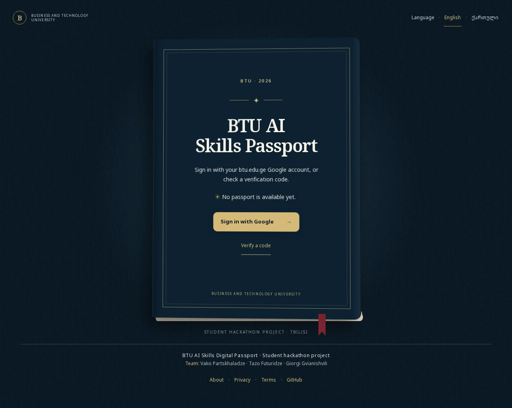
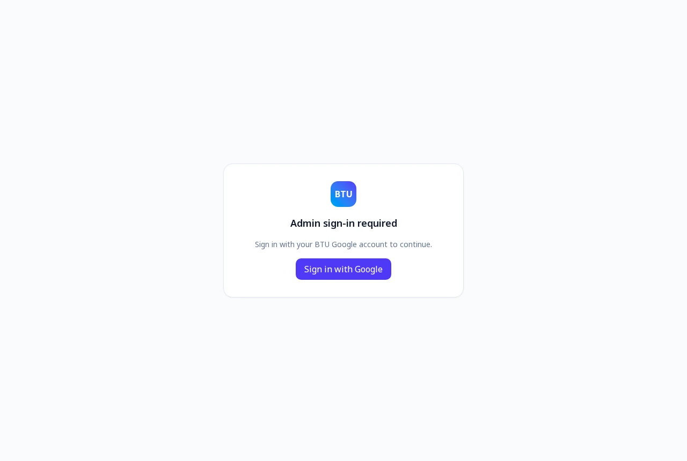
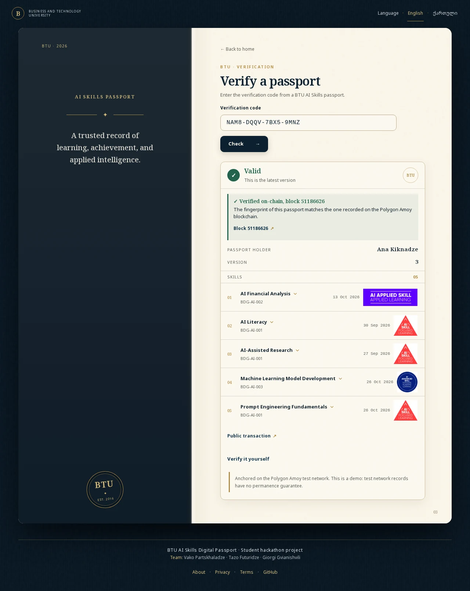
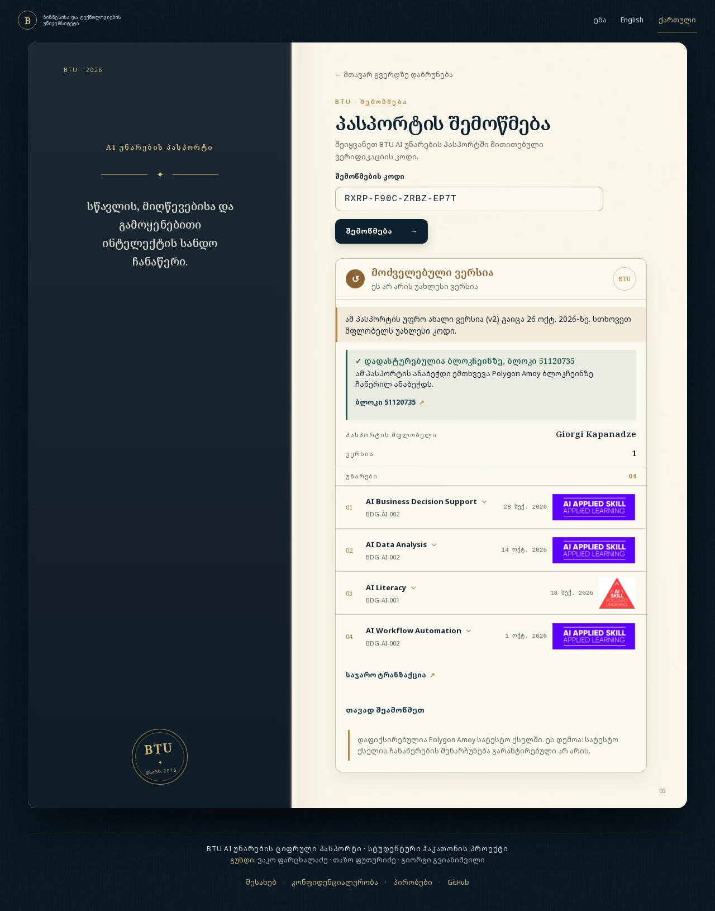
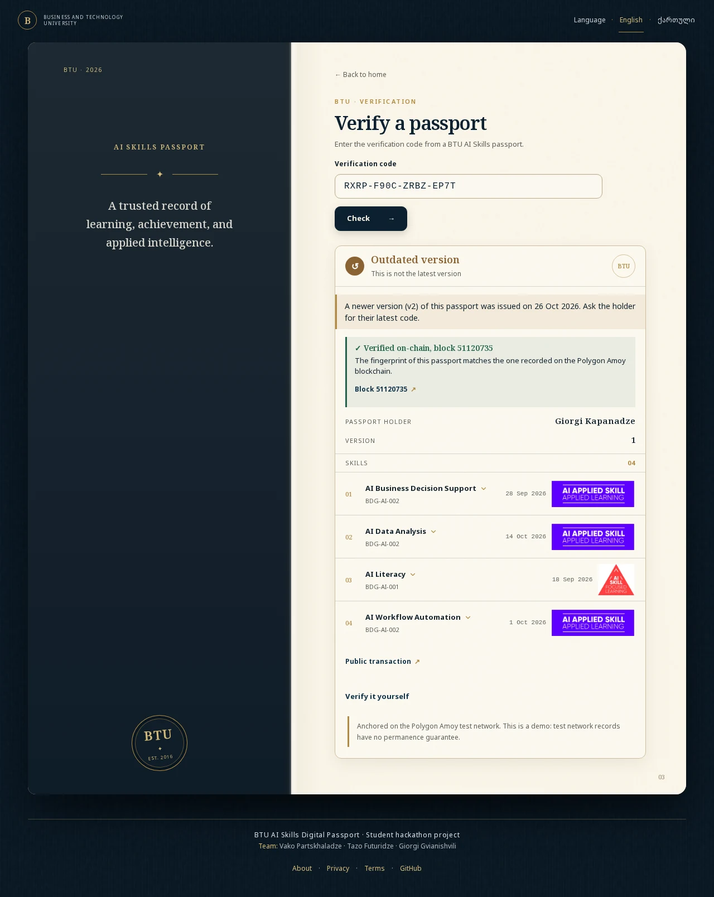
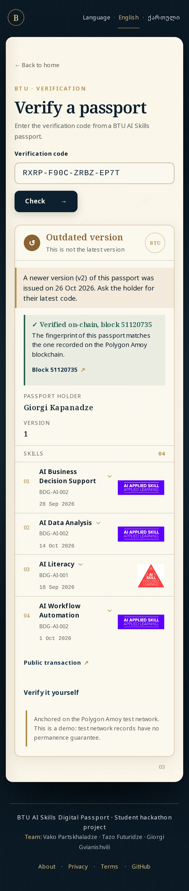
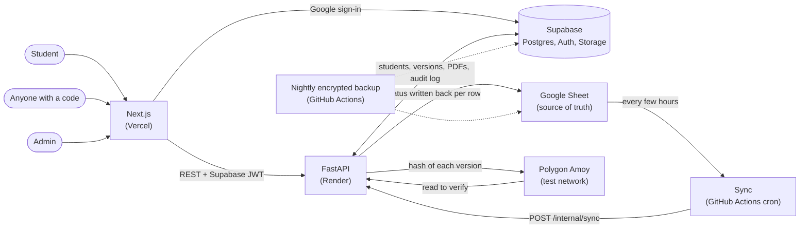

# BTU AI Skills Digital Passport

[](https://github.com/Vako-Farcxa/btu-ai-passport/actions/workflows/ci.yml)

**Live: [btu-ai-passport.vercel.app](https://btu-ai-passport.vercel.app)**

## What it is

A paper certificate can be forged and a PDF can be edited. This project gives each student a passport of AI skills that anyone can check. A team keeps awards in a Google Sheet, students sign in with their btu.edu.ge account to see their passport and download English or Georgian PDFs, and anyone can check a passport with its verification code. Every version is anchored on a public blockchain, so a changed passport can be told apart from the original, and a revoked one is shown as revoked.

It is also a test-engineering showcase: the interesting part is how it is checked. More than 1,500 automated tests run on every push, including tests on a real Postgres, tests on a real EVM, browser tests with accessibility checks, and browser tests against the real backend. See [Testing](#testing).

> **Disclaimer:** this is a student hackathon project. It is a demo and **not an official BTU service**.
> **Testnet:** passport versions are anchored on the **Polygon Amoy test network**. Test network data can be reset, so there is no guarantee a record stays available.

## Try it

Sign-in is limited to btu.edu.ge accounts, but the public verify page needs no account. Open the live result for a sample passport:

**[Verify `NAM8-DQQV-7BX5-9MNZ`](https://btu-ai-passport.vercel.app/verify?code=NAM8-DQQV-7BX5-9MNZ)** (or paste the code into the field at [/verify](https://btu-ai-passport.vercel.app/verify)).

It is a fictional student's latest passport version, so it shows **Valid, latest version** with the on-chain check. All names and data are fictional sample data. (The first request can take up to a minute while the free API server wakes up.)

| Home | Admin sign-in gate |
| --- | --- |
|  |  |

| Verify result, English | Verify result, Georgian |
| --- | --- |
|  |  |

| Outdated version |
| --- |
|  |

The last shot shows an older version of a passport. It is flagged as Outdated and points to the newer version, while its fingerprint still matches the one recorded on chain.

Mobile (390 px wide):



The screenshots were taken on the live site. All names and data are fictional sample data, not real students.

## Features

- Sign in with a btu.edu.ge Google account and see your own passport, version by version.
- Download each version as a PDF in English or Georgian.
- Public verification page: enter a code and see the holder name, version, skills and whether it is the latest version. It never shows email or passport ID.
- Share link per version (`/verify?code=...`).
- Blockchain anchoring on Polygon Amoy, with a public transaction link per version.
- Admin panel behind an allow-list: award skills, add students, manage the skills catalog, watch syncs and anchors, review student flags, revoke a version or archive a student.
- Activity log: every change made in the admin panel is recorded with who did it and when (`/admin/audit`). A failed log write never blocks the change itself.
- Google Sheet stays the source of truth. A scheduled sync (GitHub Actions) runs every few hours and writes the result back to each row.
- Students can flag an issue on a version and read the admin reply.
- English and Georgian interface, About, Privacy and Terms pages.

## Architecture



How a passport gets from the Sheet to a verifiable record:

1. The sync reads the Sheet, checks every row and groups rows by student. A student whose rows have a problem is marked `FAILED` in the Sheet with a reason, and nothing is stored for them.
2. For a student with changes, one database function creates the new version and its skills in a single transaction, so a crash cannot leave half a passport.
3. A hash of the version (name, passport ID, version number, skills) is written to the `PassportAnchor` contract. The contract allows each slot to be written once.
4. The verify page recomputes the hash from the stored data and compares it with the database and with the contract. Only hashes go on the blockchain, never names, emails or skills.

## Tech stack

- **Frontend:** Next.js 16, React 19, TypeScript, Tailwind CSS 4, GSAP, zod, Vitest and Playwright
- **Backend:** Python 3.12, FastAPI, gspread, reportlab and pypdf, web3.py, pytest, ruff and mypy
- **Data and auth:** Supabase (Postgres, Google sign-in, Storage)
- **Chain:** Polygon Amoy test network
- **Hosting:** Vercel (web), Render (API), GitHub Actions (sync schedule)

## Structure

- `frontend/`: Next.js app (sign-in, passport, public verify page, admin panel)
- `backend/`: FastAPI service (sheet sync, PDFs, verification, Amoy anchoring)
- `supabase/`: database migrations
- `docs/contract/`: contract ABI and Solidity source
- `docs/screenshots/`: images used in this README
- `docs/sheet-format.md`: the Google Sheet column contract
- `docs/RESTORE.md`: how to restore a backup
- `.github/workflows/sync.yml`: requests the sheet sync every 15 minutes; GitHub's free scheduler delays it, so it really runs about every 4 hours
- `.github/workflows/backup.yml`: nightly encrypted backup of the database and the Sheet (`docs/RESTORE.md` explains how to restore)
- `.github/workflows/ci.yml`: tests and checks on every push and pull request (`.github/scripts/` has the migration check, `.github/dependabot.yml` the update schedule)

## Run locally

Backend (without Supabase variables it runs on demo data):

```bash
cd backend
uv run uvicorn passport_api.main:app --reload
```

Frontend:

```bash
cd frontend
cp .env.example .env.local   # fill in Supabase URL and anon key
npm install
npm run dev
```

Open http://localhost:3000. Without Supabase variables the backend serves built-in demo data, and `K9M2-N3P4-Q5R6-S7T8` is its (outdated, version 1) sample code. The live site's sample code is in [Try it](#try-it).

## Verify a passport yourself

Every passport version is anchored on the **Polygon Amoy test network** in the `PassportAnchor` contract:

- Contract address: [`0xf436Ba2A2cd1dc78f1543A1E7e8a9f20B2C40c32`](https://amoy.polygonscan.com/address/0xf436Ba2A2cd1dc78f1543A1E7e8a9f20B2C40c32)
- ABI: [`docs/contract/PassportAnchor.abi.json`](docs/contract/PassportAnchor.abi.json)
- Source: [`docs/contract/PassportAnchor.sol`](docs/contract/PassportAnchor.sol). Once the source is published on Polygonscan ("Verify and Publish", Solidity 0.8.26, optimizer settings of the deployment), its Read Contract tab works directly. Until then use the script below, or load the ABI in Remix ("At Address").

The contract stores one mapping, `anchors(verificationIdHash) -> contentHash`. A slot can be written once and never changed.

**What the verify page does.** For a confirmed code it recomputes the content hash from the stored name, passport ID, version and skills, compares it with the hash stored in the database, then reads the contract and compares again. Results:

| Result | Meaning |
|---|---|
| Valid / Outdated version, badge "Verified on-chain, block N" | Database and contract agree. |
| "Does not match the blockchain" (no name, no skills) | The stored passport changed, or the contract holds a different hash or none. |
| Valid, badge "On-chain check unavailable, try later" | The RPC could not be reached in 3 seconds. The database result is shown, but it is never called verified. |

**Check it without trusting this site**

1. On the verify result, open "Verify it yourself". It lists the contract address, the key and the expected fingerprint.
2. Open the contract on [Polygonscan](https://amoy.polygonscan.com/address/0xf436Ba2A2cd1dc78f1543A1E7e8a9f20B2C40c32#readContract) and go to Read Contract (or load `docs/contract/PassportAnchor.abi.json` in Remix at the same address).
3. Call `anchors` with the key. It returns the content hash. It must equal the expected fingerprint. All zeros means nothing is anchored for that code.

The key is `keccak256` of the verification code in upper case (UTF-8). The content hash is `keccak256` of this compact JSON, with keys sorted and text normalised (Unicode NFC, trimmed):

```json
{"holder_name":"...","passport_id":"BTU-...","skills":[{"awarded_on":"2025-06-01","badge":"...","skill":"..."}],"version":2}
```

Skills are sorted by skill, badge and date (a missing date last), and exact duplicates are collapsed. `awarded_on` is `null` when there is no valid date.

**Script.** To recompute the hash from a passport's facts and compare it with the contract, with no BTU server involved:

```bash
cd backend
uv run python scripts/verify_onchain.py --code ABCD-EFGH-IJKL-MNOP --passport passport.json
```

`passport.json` holds `holder_name`, `passport_id`, `version` and `skills` (`skill`, `badge`, `awarded_on`). It needs a Polygon Amoy RPC URL (a public one is the default, override with `--rpc`) and no key. Exit code 0 is verified, 1 is a mismatch or not anchored, 2 means the chain could not be read.

**Backend settings for the on-chain check** (all optional beyond the existing `AMOY_RPC_URL`):

- `AMOY_RPC_URL`: the RPC node to read from. Without it the badge always says the check is unavailable.
- `ANCHOR_CONTRACT_ADDRESS`: defaults to the published address above.
- `ONCHAIN_VERIFY` (default `true`): set `false` to turn the on-chain read off.
- `ONCHAIN_TIMEOUT_SECONDS` (default `3`): timeout of each RPC request.

Reads are cached in memory: a filled slot for 24 hours (it cannot change), an empty one for 1 minute, and after a failed read the RPC is left alone for 30 seconds. A free public RPC is therefore asked about each version about once a day.

## Google Sheet

The sync reads BTU's official test sheet layout (title rows above the header, with `BTU Email (Test)`, `Passport ID (Existing)`, `Skill Name`, `Date Earned` and so on) as well as the old `email, full_name, skill, badge, awarded_on` layout. Existing Passport IDs are kept. A new student needs a full name of letters only (Latin or Georgian) and, if a passport ID is typed, 4 to 40 capital letters, digits and dashes. A date must be `YYYY-MM-DD` or empty. If any row of a student has a bad value, none of that student's rows are saved and each row says why, so nothing is guessed. After each run it writes `Passport Sync Status` (`SYNCED`/`FAILED`), `Synced Passport Version` (`V1`, `V2`...), `Synced At (UTC)` and `Sync Error / Notes` back to each row. Full rules: [`docs/sheet-format.md`](docs/sheet-format.md).

Setup: share the sheet with the service account as Editor, set `SHEET_ID` and `GOOGLE_SERVICE_ACCOUNT_JSON` in `backend/.env`, and set `ALLOWED_EMAIL_DOMAINS=btu.edu.ge,example.org` to accept the test emails. Run the files in `supabase/migrations/` in order.

## Monitoring and backups

### Health checks

- `GET /health`: the API process is alive. It touches nothing else, so it is cheap and safe to ping often.
- `GET /health/ready`: checks the database, the Google Sheet and the Amoy RPC and reports each one. `200` when the database works (overall `ok`, or `degraded` if only the Sheet or the chain is down), `503` when it does not. The answer is cached for 60 seconds, so frequent pings cannot use up the Sheets or RPC quotas, and it never shows a URL or secret.
- The admin dashboard (`/admin`) shows a red or amber banner when the last sync failed (with the reason), no sync has finished for over an hour, an anchor is stuck or gave up, or the database consistency check finds problems.

### Uptime monitoring with UptimeRobot (free)

The free plan checks every 5 minutes, which also keeps the free Render service from falling asleep (it sleeps after 15 minutes without a request).

1. Sign up at [uptimerobot.com](https://uptimerobot.com) and open the dashboard.
2. **Add New Monitor**, type **HTTP(s)**, friendly name `BTU Passport API`, URL `https://<your-api>.onrender.com/health`, interval **5 minutes**. Under **Alert contacts** tick your email. Create it. (The free plan checks with HEAD, which `/health` answers.)
3. Optional, to also hear about a broken Sheet or chain: **Add New Monitor**, type **Keyword**, URL `https://<your-api>.onrender.com/health/ready`, keyword `degraded`, **Alert when: keyword exists**, interval 5 minutes, same email. This one also goes red on its own when the database is down, because `/health/ready` then answers 503.

### Nightly backup

`.github/workflows/backup.yml` runs every night at 02:05 Tbilisi time (and on demand from the Actions tab). It saves every database table and every Sheet tab, packs them into one file, **encrypts it with AES-256**, and keeps it as a workflow artifact for 30 days. The repository is public and signed-in GitHub users can download artifacts of a public repository, so the encryption is what keeps the data private. Add these repository secrets first (Settings, Secrets and variables, Actions, New repository secret):

| Secret | What it is |
| --- | --- |
| `SUPABASE_URL` | The same value as on Render (`https://xxxx.supabase.co`). |
| `SUPABASE_SERVICE_ROLE_KEY` | The same service role key as on Render. |
| `GOOGLE_SERVICE_ACCOUNT_JSON` | The same service account JSON as on Render. The backup only reads the Sheet. |
| `SHEET_ID` | The same Sheet id as on Render. |
| `BACKUP_PASSPHRASE` | A new long random passphrase (at least 16 characters). Keep a copy in your password manager: without it a backup cannot be opened, and nobody can reset it. |

Run it by hand and check it, then restore: see [`docs/RESTORE.md`](docs/RESTORE.md). If a run fails (a missing secret, the Sheet no longer shared with the service account), GitHub emails you. GitHub also switches scheduled workflows off after 60 days without any repository activity, so look at the Actions tab now and then.

## Testing

More than 1,500 automated tests run on every push and pull request (GitHub Actions, `.github/workflows/ci.yml`, no secrets needed):

| Suite | Tests | Coverage | What it covers | Run it locally |
| --- | --- | --- | --- | --- |
| Backend (pytest) | 925 | 96% of lines, 95% with branches | API, sync and Sheet rules, verification, on-chain check, PDFs, rate limits, security headers, health checks, audit log, backup and restore, error shape | `cd backend && uv run pytest` |
| Frontend unit and component (Vitest) | 474 | 77% of statements, 73% of branches | validation, formatting, API client, hooks, components, admin pages, sign-in callback | `cd frontend && npm test` |
| End-to-end, API mocked (Playwright, Chromium) | 107 | user flows, phone-size accessibility, first-paint language | see the list below | `cd frontend && npm run e2e` |
| End-to-end, real backend (Playwright, Chromium) | 5 | front end and FastAPI together, nothing mocked | valid, outdated, unknown, revoked, tampered and pending codes, and the admin gate | `cd frontend && npm run e2e:real` (needs `uv`) |

Coverage numbers come from `uv run pytest --cov=passport_api --cov-branch` and `npm run test:coverage`. The frontend number is lower on purpose: animation code and the Supabase browser session are exercised by the Playwright specs instead of by unit tests that would only repeat mocks.

### What the tests check

- **Real Postgres.** The migrations and the SQL functions (atomic sync, revert to an older skill set, audit table) run on a real Postgres started by the `pgserver` dev dependency. Constraint rules are tested where they live, not through a mock.
- **Real EVM.** `PassportAnchor` is deployed from its committed artifact into an in-memory chain (py-evm through eth-tester). The tests check that only the issuer can write, a slot can be written once, the event is emitted, and that the app's own calldata, nonce and receipt handling work against a real contract.
- **One spec, two stores.** The flag store is tested with one set of contract tests that run against the in-memory store and the Supabase store, so the two cannot drift apart.
- **Sheet rules.** Table-driven tests cover every way a Sheet row can be wrong (bad name, bad passport ID, bad date, a bad row among good ones). A bad date fails the whole student instead of guessing.
- **Concurrency.** Two admins awarding at once must not get the same ID or overwrite each other's rows. The test fails if the lock is removed.
- **Privacy.** Log lines are searched for emails and exception text after a failure. Error responses never echo input.
- **Mutation checks.** The riskiest tests were checked by removing the code they protect and watching them fail.
- **End-to-end flows.** Verify a valid, outdated, pending, revoked, tampered and unknown code, in English and Georgian; a student flags a version; an admin answers the flag; an admin adds a student; the activity log; sign-in and keyboard use; security headers and the rate-limit message.
- **Accessibility.** `@axe-core/playwright` scans the public pages, a verify result, the student passport page with the flag dialog, and the admin pages for serious WCAG A and AA violations. The scan found real contrast and label problems, which are fixed. Every page also has a skip link, and header and footer targets are at least 44 px tall (both are tested).
- **Real backend.** The mocked browser specs are fast, but they cannot notice that the front end and the API stopped agreeing. A separate CI job starts the real FastAPI app with seeded fixture data (`backend/scripts/serve_e2e.py`, no secrets, the blockchain replaced by a scripted contract) and the real Next.js build, and drives them with an unmocked browser. A renamed JSON field or a broken CORS or security header fails that job while the mocked suite stays green.
- **Phone size.** The accessibility scan also runs at 390 px wide (public pages, a verify result, an admin page). It found an unnamed logo link and admin tables that keyboard users could not scroll, both fixed.
- **First paint.** With JavaScript switched off, the server HTML of every page is checked for the right language (saved choice, then Accept-Language), so a visitor never sees the wrong language flash.
- **Stable browser tests.** Tests wait until React has attached its handlers before clicking, which removed a flaky empty-code check.

### CI jobs

The CI jobs, with the check names GitHub shows:

- **Backend:** `ruff format --check`, `ruff check`, `mypy` (strict) and `pytest` with a coverage report.
- **Frontend:** `tsc`, ESLint, Prettier, Vitest with a coverage report and a production `next build` that must have an https API address.
- **E2E (Playwright):** the specs against the production build, with every API call mocked in the browser.
- **E2E real backend (Playwright):** the same production build against the real FastAPI backend with seeded fixture data and nothing mocked.
- **Migrations:** every file in `supabase/migrations` applied in order to an empty Postgres 17, the newest one applied twice, and the sync and admin functions checked.
- **Secret scan:** gitleaks over the full history, fails on any leaked key.

Dependabot opens weekly pull requests for Python, npm and GitHub Actions updates (minor and patch updates are grouped). The frontend needs Node 24 (`frontend/.nvmrc`).

Before opening a pull request, run the same checks locally:

- Backend: `uv run ruff format . && uv run ruff check . && uv run mypy . && uv run pytest`
- Frontend: `npm run check`, `npm run e2e` and `npm run e2e:real`

## Team

Vako Partskhaladze, Tazo Futuridze, Giorgi Gvianishvili.

Source: https://github.com/Vako-Farcxa/btu-ai-passport

## License

[MIT](LICENSE), copyright 2026 Vako Partskhaladze, Tazo Futuridze, Giorgi Gvianishvili.
