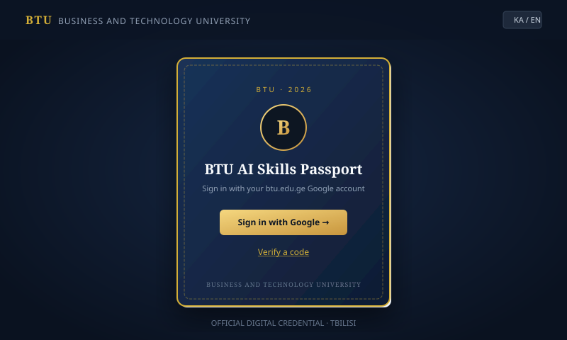
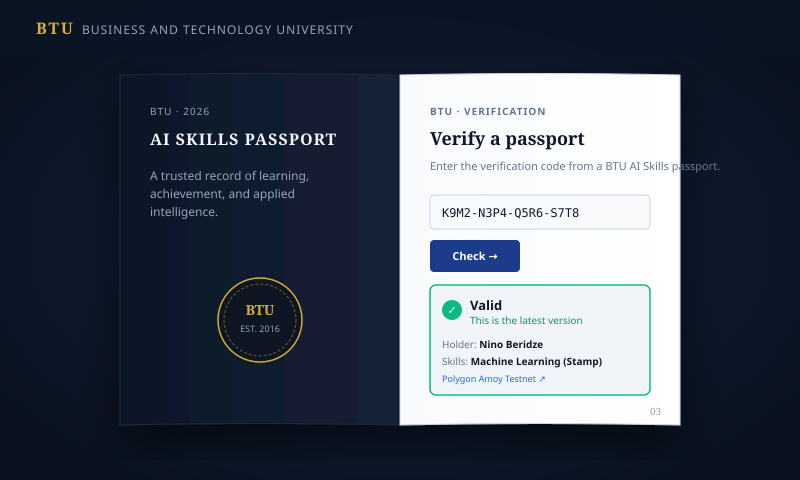

# BTU AI Skills Digital Passport

[](https://github.com/Vako-Farcxa/btu-ai-passport/actions/workflows/ci.yml)
[](LICENSE)
[](https://amoy.polygonscan.com/)

Issues verifiable AI skills passports to Business and Technology University (BTU) students. Passports sync idempotently from an official university Google Sheet registry, students authenticate with their institutional `@btu.edu.ge` Google accounts to inspect version history and export bilingual PDFs, and employers/public viewers can verify credentials via unique verification codes anchored on the Polygon Amoy testnet.

---

### Preview & Screenshots

<p align="center">
  
  
</p>

---

## 📌 Repository About Box

- **Description:** Verifiable AI skills digital passports for BTU students, featuring automated Google Sheets sync, bilingual PDF credentials, and zero-knowledge Polygon Amoy testnet proof anchoring.
- **Website:** [https://btu-ai-passport.onrender.com](https://btu-ai-passport.onrender.com) (or local `http://localhost:3000`)
- **Topics/Tags:** `nextjs`, `fastapi`, `supabase`, `blockchain`, `polygon-amoy`, `testnet`, `digital-credentials`, `education`, `ai-skills`, `georgia`, `btu`

---

## Key Features

- **Institutional Google Authentication:** Restricted to authorized `@btu.edu.ge` accounts.
- **Physical Passport UI:** Tactile book cover, textured folios, and seal stamps designed with GSAP animations.
- **Cryptographic Testnet Anchoring:** Passports are hashed with SHA-256 and anchored to the Polygon Amoy testnet with verifiable transaction links. Zero personal data touches the chain.
- **Rate-Limited Public Verification:** Sliding-window rate limiter protecting `/verify` against brute-force code enumeration.
- **Comprehensive Footers & Legal Pages:** Clear academic testnet notices, disclaimers, and dedicated `/about`, `/privacy`, and `/how-it-works` pages.
- **Automated Sheet Sync:** Scheduled GitHub Actions workflow syncing Google Sheets with atomic DB locking and per-row error tracking.

---

## Structure

- `frontend/`: Next.js 16 app (Sign-in, Passport viewer, public Verify, About/Privacy/How-it-works)
- `backend/`: FastAPI service (Google Sheets sync, ReportLab PDF generation, Amoy anchoring, rate limiter)
- `supabase/`: Postgres schemas and migrations
- `specs/`: Spec-Kit requirements, data models, contracts, and tasks
- `.github/workflows/`:
  - `ci.yml`: Continuous Integration running full frontend and backend test suites, typechecks, and linters.
  - `sync.yml`: Periodic 15-minute background sheet synchronization.

---

## Run Locally

### 1. Backend

```bash
cd backend
uv sync
PYTHONPATH=src uv run uvicorn passport_api.main:app --reload
```

### 2. Frontend

```bash
cd frontend
cp .env.example .env.local   # fill in Supabase URL and anon key
npm install
npm run dev
```

Open [http://localhost:3000](http://localhost:3000). Try verifying with the demo code: `K9M2-N3P4-Q5R6-S7T8`.

---

## Google Sheet Integration

The sync reads BTU's official test sheet layout (headers on row 3: `BTU Email (Test)`, `Passport ID (Existing)`, `Skill Name`, `Date Earned`, etc.) with fallback to flat schemas. After sync, status columns (`SYNCED`/`FAILED`), version tags, timestamps, and error notes are written back to the sheet. See `specs/001-ai-skills-passport/contracts/sheet.md`.

---

## Automated Checks & CI

Run local checks before pushing:

- **Backend:** `uv run ruff check . && uv run ruff format --check . && uv run mypy . && PYTHONPATH=src uv run pytest`
- **Frontend:** `npm run check` (runs `typecheck`, `lint`, `format:check`, and `vitest`)

---

## License

This project is licensed under the [MIT License](LICENSE).
