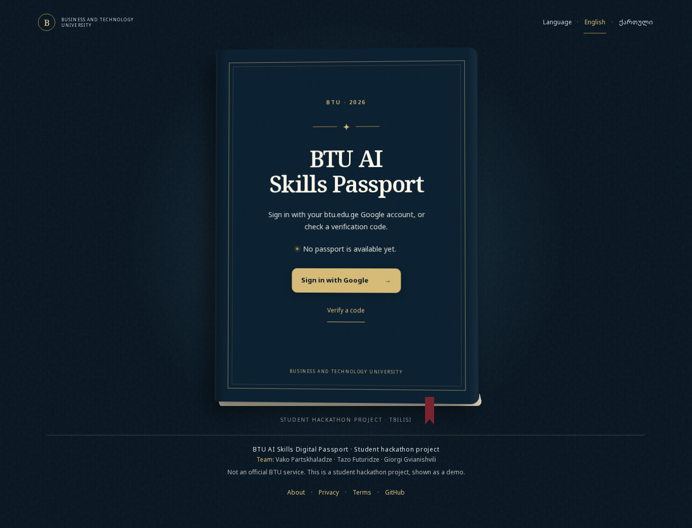
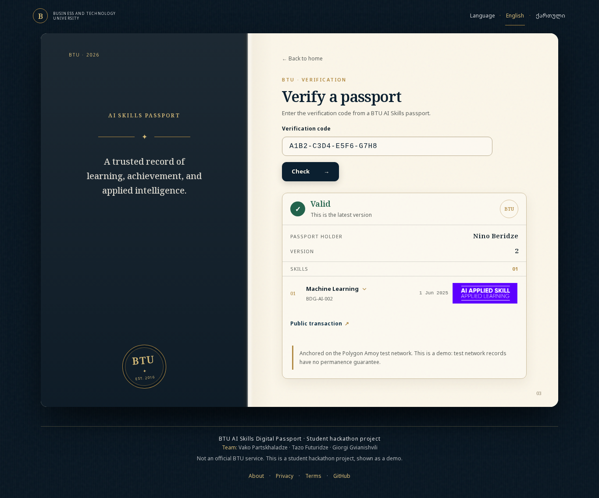
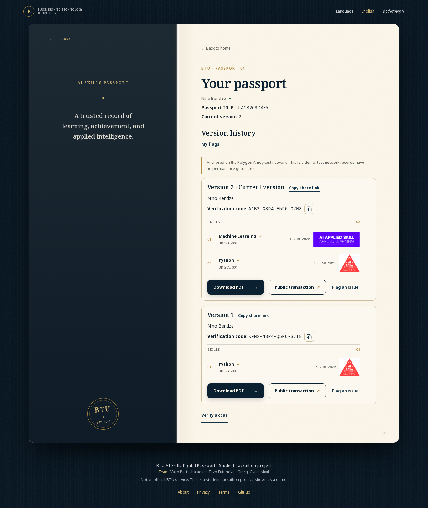
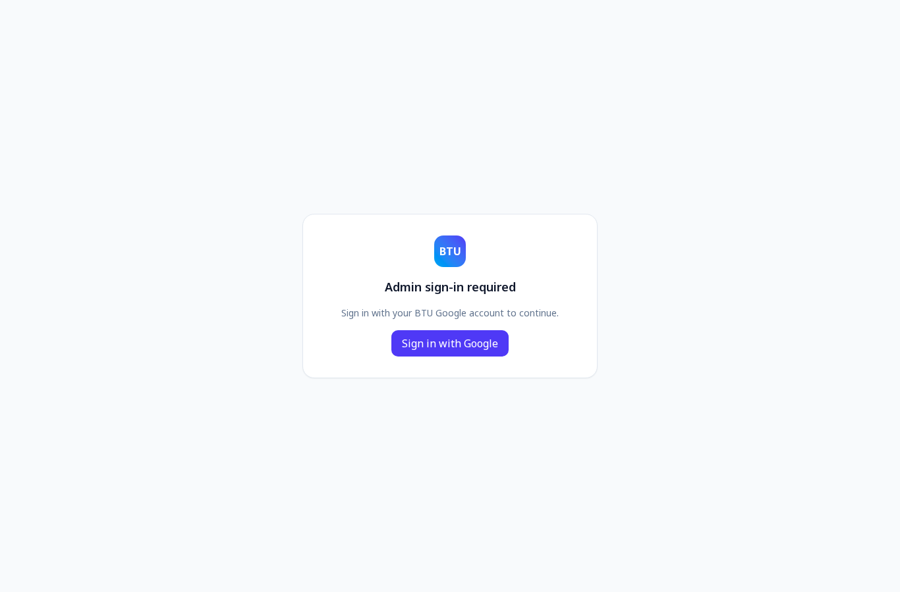
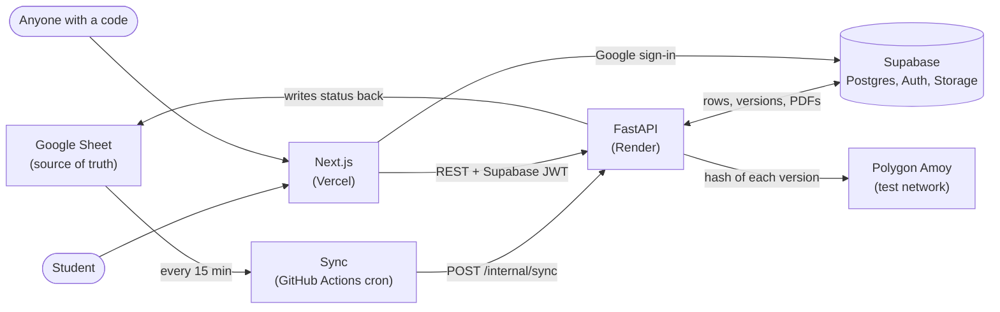

# BTU AI Skills Digital Passport

**Live: [btu-ai-passport.vercel.app](https://btu-ai-passport.vercel.app)**

Verifiable AI skills passports for BTU students. A team keeps awards in a Google Sheet, students sign in with their btu.edu.ge account to see their passport and download English or Georgian PDFs, and anyone can check a passport with its verification code. Every version is anchored on a public blockchain, so a changed passport can be told apart from the original.

> **Disclaimer:** this is a student hackathon project. It is a demo and **not an official BTU service**.
> **Testnet:** passport versions are anchored on the **Polygon Amoy test network**. Test network data can be reset, so there is no guarantee a record stays available.

| Home | Verify result |
| --- | --- |
|  |  |

| Student passport | Admin sign-in gate |
| --- | --- |
|  |  |

The screenshots use fictional sample data (a demo student, Nino Beridze), not real students.

## Features

- Sign in with a btu.edu.ge Google account and see your own passport, version by version.
- Download each version as a PDF in English or Georgian.
- Public verification page: enter a code and see the holder name, version, skills and whether it is the latest version. It never shows email or passport ID.
- Share link per version (`/verify?code=...`).
- Blockchain anchoring on Polygon Amoy, with a public transaction link per version.
- Admin panel behind an allow-list: award skills, add students, manage the skills catalog, watch syncs and anchors, review student flags.
- Google Sheet stays the source of truth. A sync runs every 15 minutes and writes the result back to each row.
- Students can flag an issue on a version and read the admin reply.
- English and Georgian interface, About, Privacy and Terms pages.

## Architecture



Only hashes go on the blockchain, never names, emails or skills.

## Tech stack

- **Frontend:** Next.js 16, React 19, TypeScript, Tailwind CSS 4, GSAP, zod, Vitest and Playwright
- **Backend:** Python 3.12, FastAPI, gspread, reportlab and pypdf, web3.py, pytest, ruff and mypy
- **Data and auth:** Supabase (Postgres, Google sign-in, Storage)
- **Chain:** Polygon Amoy test network
- **Hosting:** Vercel (web), Render (API), GitHub Actions (sync schedule)

## Structure

- `frontend/`: Next.js app (sign-in, passport, public verify page, admin panel)
- `backend/`: FastAPI service (sheet sync, PDFs, verification, Amoy anchoring)
- `supabase/`: database migrations
- `specs/`: spec-kit specification, plan and tasks
- `docs/screenshots/`: images used in this README
- `.github/workflows/sync.yml`: runs the sheet sync every 15 minutes

## Run locally

Backend (without Supabase variables it runs on demo data):

```bash
cd backend
uv run uvicorn passport_api.main:app --reload
```

Frontend:

```bash
cd frontend
cp .env.example .env.local   # fill in Supabase URL and anon key
npm install
npm run dev
```

Open http://localhost:3000. Try verifying with the demo code `K9M2-N3P4-Q5R6-S7T8` against the demo backend.

## Google Sheet

The sync reads BTU's official test sheet layout (title rows above the header, with `BTU Email (Test)`, `Passport ID (Existing)`, `Skill Name`, `Date Earned` and so on) as well as the old `email, full_name, skill, badge, awarded_on` layout. Existing Passport IDs are kept. After each run it writes `Passport Sync Status` (`SYNCED`/`FAILED`), `Synced Passport Version` (`V1`, `V2`...), `Synced At (UTC)` and `Sync Error / Notes` back to each row. Full rules: `specs/001-ai-skills-passport/contracts/sheet.md`.

Setup: share the sheet with the service account as Editor, set `SHEET_ID` and `GOOGLE_SERVICE_ACCOUNT_JSON` in `backend/.env`, and set `ALLOWED_EMAIL_DOMAINS=btu.edu.ge,example.org` to accept the test emails. Run the files in `supabase/migrations/` in order.

## Checks

- Backend: `uv run ruff format . && uv run ruff check . && uv run mypy . && uv run pytest`
- Frontend: `npm run check` and `npm run e2e`

## Team

Vako Partskhaladze, Tazo Futuridze, Giorgi Gvianishvili.

Source: https://github.com/Vako-Farcxa/btu-ai-passport

## License

[MIT](LICENSE), copyright 2026 Vako Partskhaladze, Tazo Futuridze, Giorgi Gvianishvili.
